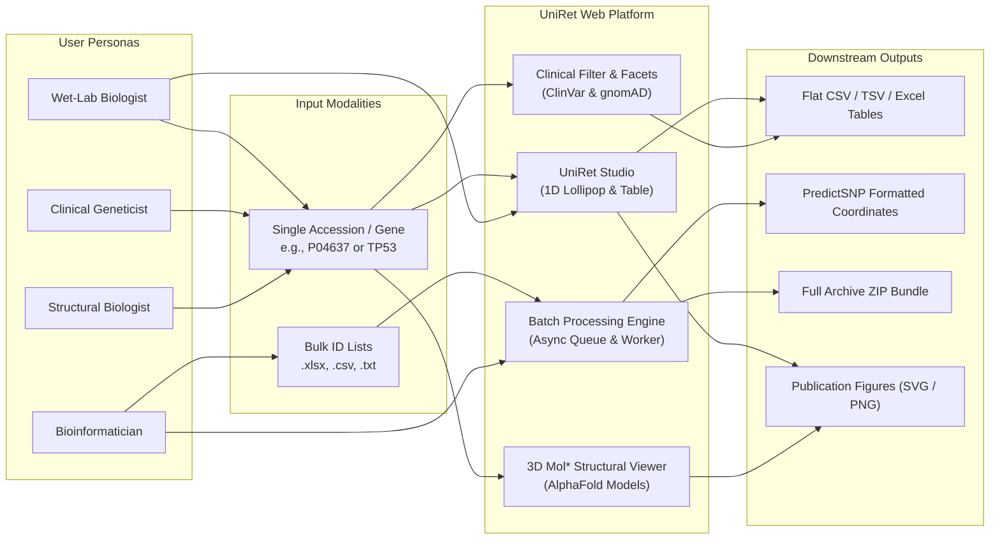
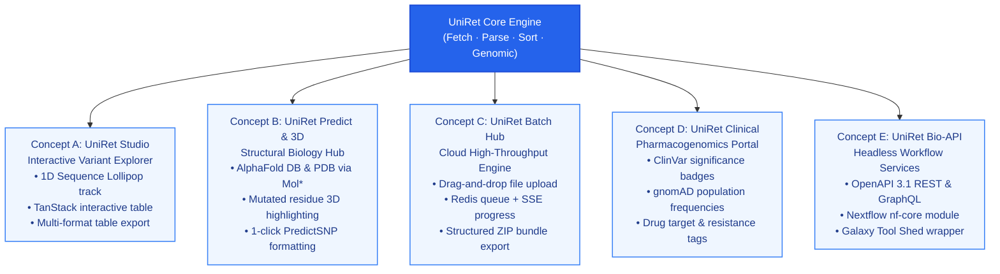
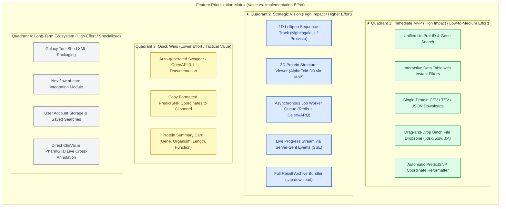
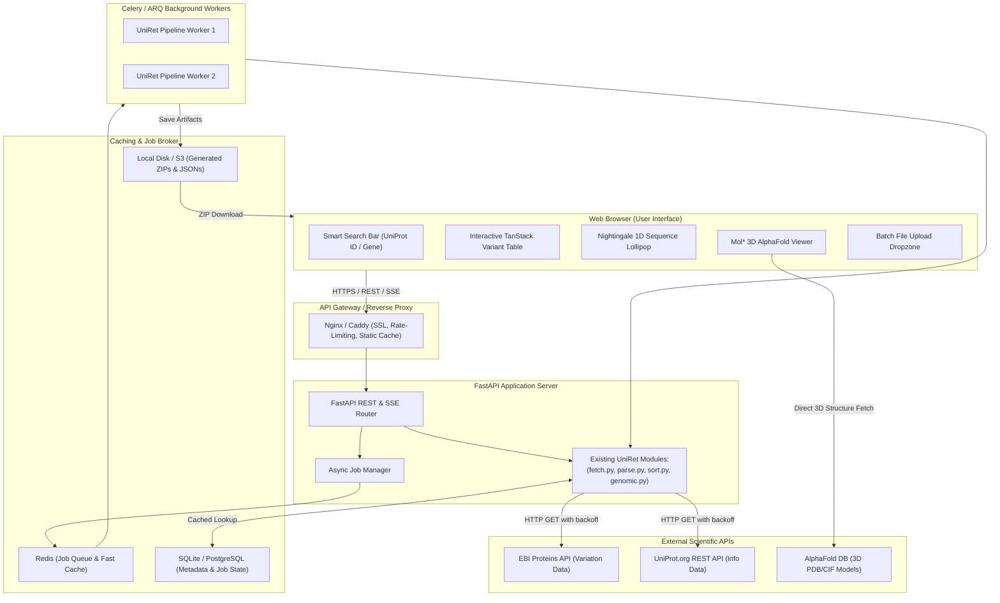
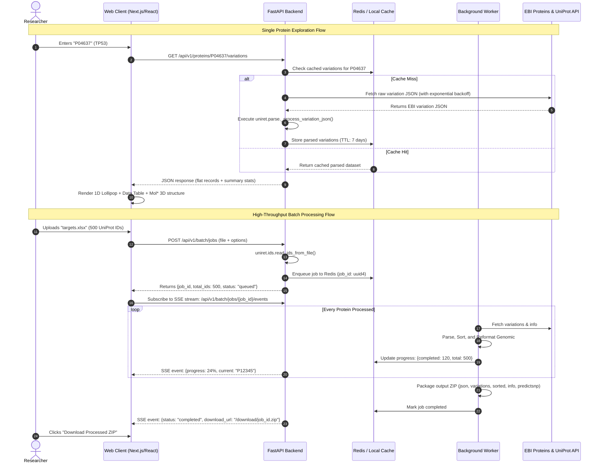
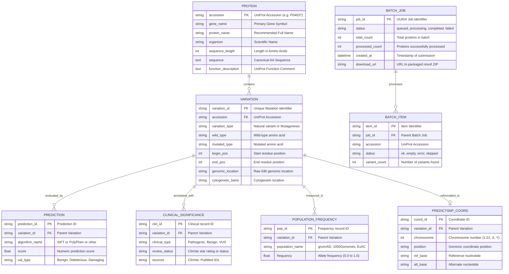
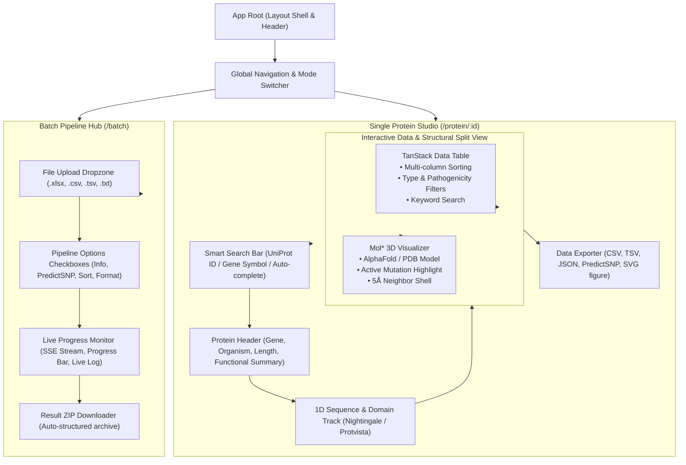
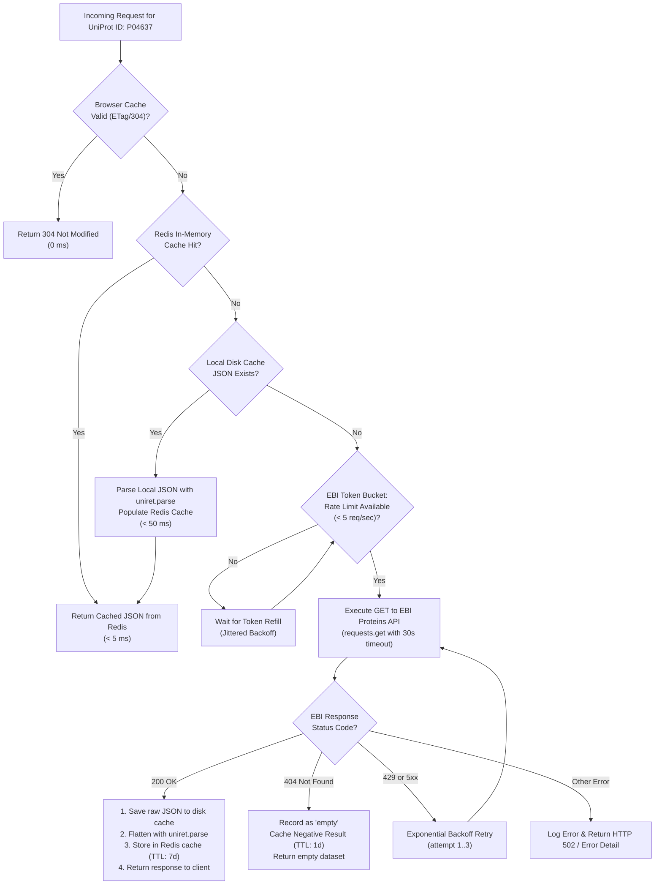
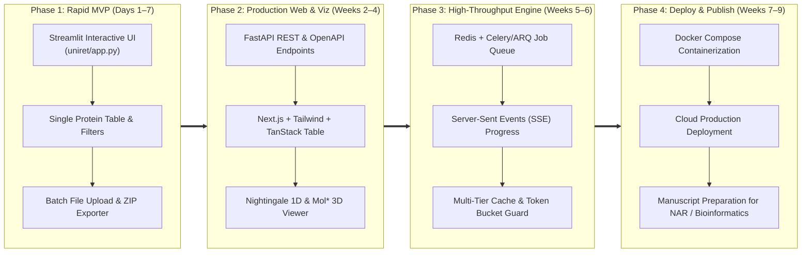

# UniRet Web Platform — Vision, Ideas, & Architecture (Potential.md)

> **Document Status**: Proposal & Architecture Specification  
> **Target System**: UniRet Webtool (Transforming the UniRet CLI into an Interactive Web Application & Bioinformatics Hub)  
> **Author / Maintainer**: Sushant Nimbhorkar & Contributors  
> **Last Updated**: November 2026  

---

## Table of Contents
1. [Executive Summary & Motivation](#1-executive-summary--motivation)
2. [Target Personas & User Scenarios](#2-target-personas--user-scenarios)
3. [Brainstormed Webtool Archetypes & Concepts](#3-brainstormed-webtool-archetypes--concepts)
   - [Concept A: UniRet Studio (Interactive Variant Explorer & Visualizer)](#concept-a-uniret-studio-interactive-variant-explorer--visualizer)
   - [Concept B: UniRet Predict & 3D Structural Portal](#concept-b-uniret-predict--3d-structural-portal)
   - [Concept C: UniRet Batch & Cloud Processing Hub](#concept-c-uniret-batch--cloud-processing-hub)
   - [Concept D: Clinical & Pharmacogenomics Variant Portal](#concept-d-clinical--pharmacogenomics-variant-portal)
   - [Concept E: UniRet Developer Bio-API & Workflow Integration](#concept-e-uniret-developer-bio-api--workflow-integration)
4. [Feature Matrix & Prioritization (Impact vs. Effort)](#4-feature-matrix--prioritization-impact-vs-effort)
5. [System Architecture & Tech Stack Options](#5-system-architecture--tech-stack-options)
   - [Tech Stack Comparison](#tech-stack-comparison)
   - [Recommended Production Architecture](#recommended-production-architecture)
   - [Data Flow & Sequence Diagram](#data-flow--sequence-diagram)
6. [API Specification (RESTful OpenAPI Contract)](#6-api-specification-restful-openapi-contract)
7. [UI/UX Wireframes & Component Design](#7-uiux-wireframes--component-design)
8. [Data Caching, Rate-Limiting & Performance Strategy](#8-data-caching-rate-limiting--performance-strategy)
9. [Academic & Open-Source Impact (Publication Strategy)](#9-academic--open-source-impact-publication-strategy)
10. [Step-by-Step Implementation Roadmap](#10-step-by-step-implementation-roadmap)

---

## 1. Executive Summary & Motivation

### Current State
UniRet currently exists as a Python CLI toolkit designed to automate the retrieval, flattening, sorting, and formatting of SNP variation and protein metadata from the **EBI Proteins API** and **UniProt REST API**. It solves critical data-engineering bottlenecks:
- Resolving nested, irregular JSON responses into uniform flat tabular files (CSV, TSV, JSON).
- Segregating variations by functional category (`Natural variant`, `Mutagenesis`, etc.).
- Standardizing genomic coordinates for downstream variant effect predictors such as **PredictSNP** (`NC_000007.14:g.55019281C>T` $\to$ `7,55019281,C,T`).

### Benchmark & Validation Test Data
UniRet was developed and validated against curated experimental datasets:
- **Primary Benchmark Target**: `P10721` (*KIT* / Mast/stem cell growth factor receptor Kit, Homo sapiens, 976 aa, 3,483 recorded variations across ClinVar, SIFT, PolyPhen, and population frequencies).
- **Canonical Input Spreadsheet**: [`UniRet/data/uniprotids.xlsx`](file:///home/sushant-pdx/Desktop/softwares/Uniret/UniRet/data/uniprotids.xlsx) containing the `UniprotID` column formatted for the pipeline.
- **Multi-Protein Test Suite**: [`UniRet/data/test_proteins.xlsx`](file:///home/sushant-pdx/Desktop/softwares/Uniret/UniRet/data/test_proteins.xlsx) combining `P10721` (*KIT*), `P04637` (*TP53*), `P00533` (*EGFR*), `P38398` (*BRCA1*), and `P01116` (*KRAS*).

### The Opportunity: Why a Webtool?
While the CLI is effective for automated scripting, bioinformatics workflows increasingly demand zero-configuration, interactive access for multidisciplinary teams:
1. **Accessibility**: Wet-lab researchers, clinicians, biochemists, and students often lack local Python/CLI development environments.
2. **Immediate Visual Insight**: Tables of mutations are difficult to interpret without seeing where they land on the 1D protein sequence, functional domains, or 3D protein structure.
3. **One-Stop Pipeline Integration**: Going from a UniProt ID $\to$ EBI variation $\to$ PredictSNP/FoldX format currently requires file downloads, manual reformatting, and separate tool uploads.
4. **Collaborative Sharing**: A webtool enables persistent query URLs (e.g., `uniret.org/protein/P04637`), allowing research teams to share specific variant views, filtered subsets, and publication-ready charts.

---

## 2. Target Personas & User Scenarios



| Persona | Needs & Frustrations | How the UniRet Webtool Solves It |
|---|---|---|
| **Wet-Lab Molecular Biologist** | Investigating a single protein (e.g., *EGFR*, *TP53*). Wants to see known mutations, natural variants vs. experimental mutagenesis, and clinical significance without writing code or parsing nested JSON. | Instant protein search, interactive lollipop diagram showing mutation density along domains, 1-click Excel download. |
| **Computational Bioinformatician** | Has a list of 500 candidate proteins from proteomics or RNA-seq. Needs to extract all missense variants, format genomic coordinates for PredictSNP / Ensembl VEP, and run high-throughput batch pipelines. | Drag-and-drop batch upload (`.xlsx`, `.csv`, `.txt`), asynchronous job queue, live progress indicator, and unified ZIP download of formatted datasets. |
| **Clinical Geneticist / Oncologist** | Looking for disease associations, ClinVar statuses, and population frequencies (1000 Genomes, gnomAD, ExAC) for specific patient mutations. | Faceted filtering by pathogenicity (`Pathogenic`, `Likely pathogenic`), frequency threshold sliders, and cross-links to ClinVar, dbSNP, and PubMed. |
| **Structural Biologist / Protein Engineer** | Wants to map mutations onto 3D structures (AlphaFold DB or PDB) to predict if a mutation disrupts a binding pocket or active site. | Integrated 3D structure viewer (Mol* / PDBe) with variants mapped directly onto the 3D model, colored by SIFT/PolyPhen scores. |

---

## 3. Brainstormed Webtool Archetypes & Concepts



---

### Concept A: UniRet Studio (Interactive Variant Explorer & Visualizer)
*The "Canva for Protein Variations" — zero installation, real-time interactive exploration.*

- **Core Idea**: A clean, single-page application where entering any UniProt ID (or Gene Symbol) loads a rich protein dashboard.
- **Key Features**:
  - **Smart Protein Header**: Protein full name, gene symbol, organism, sequence length, and UniProt functional annotation.
  - **Interactive 1D Sequence Viewer (Lollipop Plot)**:
    - Sequence track with marked Pfam/UniProt functional domains.
    - Lollipops for each variant positioned along residue numbers ($1 \dots L$).
    - Color-coded pins: Red (Pathogenic), Green (Benign), Blue (Mutagenesis), Grey (Uncertain/Blank).
    - Pin height proportional to population frequency or prediction severity score.
  - **Dynamic Data Grid**:
    - Ag-Grid / TanStack Table with instant column sorting, global search, and multi-filter tags.
    - Toggle between *All Variants*, *Natural Variants*, *Mutagenesis*, and *Custom Filter*.
  - **Quick Export Drawer**:
    - Download filtered view as CSV, TSV, Excel (`.xlsx`), or JSON.
    - Export publication-quality SVG/PNG of the sequence diagram.

---

### Concept B: UniRet Predict & 3D Structural Portal
*Connecting sequence variants to 3D structure and computational mutation prediction.*

- **Core Idea**: Bridging sequence-level UniRet data with 3D structural biology and machine learning predictors.
- **Key Features**:
  - **Embedded Mol* (AlphaFold DB & PDB) 3D Viewer**:
    - Automatically fetch the AlphaFold predicted structure or experimental PDB for the protein accession.
    - Highlight variant residues directly in 3D (cartoons, sticks, surface rendering).
    - Color residues by SIFT, PolyPhen-2, or AlphaMissense scores.
  - **PredictSNP Direct Dispatcher**:
    - Automatically convert all variants into PredictSNP coordinate format (`Chromosome,Position,Ref,Alt`).
    - One-click copy or direct API POST to external prediction servers (PredictSNP, Ensembl VEP, MutFunc).
  - **Residue Neighborhood Analysis**:
    - Clicking a variant in the table pivots the 3D camera to that residue and highlights interacting residues within a $5\text{ \AA}$ sphere (disulfide bridges, salt bridges, catalytic residues).

---

### Concept C: UniRet Batch & Cloud Processing Hub
*High-throughput proteomics data factory for large-scale studies.*

- **Core Idea**: The web incarnation of `uniret run -i proteins.xlsx -o ./results` with enterprise-grade asynchronous processing.
- **Key Features**:
  - **Multi-Format Dropzone**: Drag-and-drop `.xlsx`, `.csv`, `.tsv`, or `.txt` files containing thousands of UniProt IDs or Gene Names.
  - **Real-Time Job Queue & Progress Tracker**:
    - Progress bar showing retrieved, skipped, failed, and parsed proteins.
    - Live streaming logs via Server-Sent Events (SSE) or WebSockets.
  - **Custom Processing Options (Checkboxes & Sliders)**:
    - ☑ *Include general protein metadata (`uniprot_info.csv`)*
    - ☑ *Reformat genomic coordinates for PredictSNP*
    - ☑ *Split files by variation type*
    - ☑ *Output format: CSV, TSV, or JSON*
    - $\text{Delay Slider}: 0.1\text{s} - 1.0\text{s}$ (with smart rate-limiting to protect EBI servers).
  - **One-Click Download Bundle**:
    - Download everything packaged as a structured `.zip` matching the canonical UniRet directory layout (`/json`, `/variations`, `/sorted`, `/predictsnp`, `/info`).
  - **Persistent Job Links**:
    - Shareable job URL (`/jobs/9b1deb4d-...`) with results stored for 48 hours. Optional email notification when the batch run completes.

---

### Concept D: Clinical & Pharmacogenomics Variant Portal
*Specialized for medical genetics, precision oncology, and drug discovery.*

- **Core Idea**: Enriching EBI variation tables with clinical databases (ClinVar, PharmGKB, DGIdb, COSMIC).
- **Key Features**:
  - **Clinical Significance Matrix**:
    - Breakdown of variants: Pathogenic, Likely Pathogenic, VUS (Variant of Uncertain Significance), Likely Benign, Benign.
    - Review status badge (e.g., `criteria provided, multiple submitters, no conflicts`).
  - **Drug Target & Interaction Overlay**:
    - Display known FDA-approved drug targets and inhibitors interacting with the protein.
    - Flag known drug-resistance mutations (e.g., EGFR *T790M* or *C797S* for Osimertinib).
  - **Population Frequency Comparison**:
    - Interactive bar charts comparing allele frequencies across gnomAD populations (African/African American, Latino, East Asian, European, South Asian).
  - **Clinical Variant Summary Report**:
    - Generate a clean, 1-page printable or PDF medical summary report of variants identified in a gene of interest.

---

### Concept E: UniRet Developer Bio-API & Workflow Integration
*The headless backend for the computational biology ecosystem.*

- **Core Idea**: Providing a high-performance RESTful & GraphQL microservice so other bioinformatics pipelines (Galaxy, Nextflow, Snakemake, Jupyter, R/Bioconductor) can invoke UniRet programmatically.
- **Key Features**:
  - **Public REST API** with OpenAPI 3.1 (Swagger) and Redoc documentation.
  - **Galaxy Tool Wrapper**: Pre-packaged XML wrapper for the Galaxy Tool Shed, letting non-programmers build graphical pipelines with UniRet inside Galaxy.
  - **Nextflow / nf-core Module & Snakemake Wrapper**: Standardized modules for inclusion in large-scale genomic/proteomic workflows.
  - **Python / R SDK Client**: Lightweight client libraries:
    ```python
    import uniret_client as ur
    protein = ur.get_protein("P04637")
    variants_df = protein.get_variations(filter_type="Natural variant")
    predictsnp_df = protein.to_predictsnp()
    ```

---

## 4. Feature Matrix & Prioritization (Impact vs. Effort)



### Prioritized Phases
1. **Tier 1 (Immediate MVP)**: 
   - Unified Search (UniProt ID or Gene Symbol).
   - Single Protein Explorer: Interactive table + download buttons (CSV, TSV, JSON, PredictSNP).
   - Batch Upload: Upload file of IDs $\to$ asynchronous worker $\to$ download ZIP.
2. **Tier 2 (Rich Visualization & Integrations)**:
   - 1D Sequence Lollipop Track (Nightingale / Protvista).
   - 3D Mol* Structure Viewer (highlighting mutated residues on AlphaFold DB models).
   - Automatic PredictSNP download format generator.
3. **Tier 3 (Enterprise & Scientific Ecosystem)**:
   - Persistent shareable links & cached database.
   - Galaxy Tool Shed & Nextflow nf-core integration.
   - Comprehensive clinical annotation filters (ClinVar, gnomAD).

---

## 5. System Architecture & Tech Stack Options

### Tech Stack Comparison

| Component | Option 1: Low-Code Python MVP (Fastest to Prototype) | Option 2: Full-Stack Modern Web App (Recommended for Production) | Option 3: Python-Centric Reactive (HTMX/FastHTML) |
|---|---|---|---|
| **Frontend** | **Streamlit** or **Gradio** | **Next.js (React) + Tailwind CSS + TanStack Table** | **FastHTML** or **FastAPI + Jinja2 + HTMX + Alpine.js** |
| **Backend** | Native Python within Streamlit | **FastAPI** (Async Python 3.11+) | **FastAPI** or **FastHTML** |
| **Visualizations**| Altair, Plotly, Streamlit-Molstar | **Nightingale.js** (EBI) + **Mol\*** (PDBe) + **Plotly.js** | Vanilla JS wrapper for Nightingale & Mol* |
| **Job Queue** | Local threading / `st.spinner` | **Redis + Celery** or **ARQ** | **Redis + RQ** or BackgroundTasks |
| **Cache/DB** | In-memory `@st.cache_data` | **PostgreSQL + Redis** (Response caching) | **SQLite / DuckDB + Redis** |
| **Deployment** | Streamlit Cloud, Hugging Face Spaces | Docker Compose, Fly.io, AWS ECS, or Render | Single Docker container on VPS / Render |
| **Pros** | Working prototype in 1–2 days; 100% Python; minimal code. | Highly responsive; rich interactive widgets; production scale; customizable UI. | Fast development; no Node.js/build pipeline required; lightweight. |
| **Cons** | Limited UI layout control; slow for large batch table rendering; state resets easily. | Requires TypeScript/React knowledge and maintaining two codebases. | Smaller ecosystem for complex bioinformatics UI widgets (like Mol*). |

---

### Recommended Production Architecture



---

### Data Flow & Sequence Diagram



---

## 6. API Specification (RESTful OpenAPI Contract)

The webtool exposes a well-documented REST API that decouples frontend presentation from core computational logic:

### Endpoints Overview



#### 1. Protein Variation & Info Lookups
- `GET /api/v1/proteins/{uniprot_id}/info`
  - Fetches general protein metadata (name, gene, organism, length, sequence, function).
- `GET /api/v1/proteins/{uniprot_id}/variations`
  - **Query Parameters**:
    - `type`: filter by type (e.g. `Natural variant`, `Mutagenesis`).
    - `format`: `json` (default), `csv`, `tsv`.
    - `min_score`: filter by prediction score threshold.
    - `clinical_significance`: filter by status (`pathogenic`, `benign`).
- `GET /api/v1/proteins/{uniprot_id}/predictsnp`
  - Returns variants formatted specifically for PredictSNP (`chromosome,position,ref,alt`).
- `GET /api/v1/proteins/{uniprot_id}/sorted`
  - Returns variation subsets split by category.

#### 2. Batch Processing Engine
- `POST /api/v1/batch/jobs`
  - **Payload**: `multipart/form-data` containing:
    - `file`: `.xlsx`, `.csv`, `.tsv`, or `.txt` file with UniProt IDs.
    - `with_info`: boolean (default `true`).
    - `with_genomic`: boolean (default `true`).
    - `split_sorted`: boolean (default `true`).
    - `format`: `csv`, `tsv`, or `json`.
    - `delay`: float (default `0.3`).
  - **Response**:
    ```json
    {
      "job_id": "8f3b20c9-4a92-4f3b-821d-91bce9823412",
      "status": "queued",
      "total_ids": 142,
      "created_at": "2026-11-16T12:00:00Z",
      "stream_url": "/api/v1/batch/jobs/8f3b20c9.../events"
    }
    ```
- `GET /api/v1/batch/jobs/{job_id}`
  - Returns current job status, percent complete, error log, and execution summary.
- `GET /api/v1/batch/jobs/{job_id}/events`
  - Server-Sent Events (SSE) endpoint streaming real-time per-protein progress ticks.
- `GET /api/v1/batch/jobs/{job_id}/download`
  - Downloads the compiled ZIP file containing all results structured according to the standard UniRet folder hierarchy.

---

## 7. UI/UX Wireframes & Component Design



### Wireframe 1: Single Protein Studio (`/protein/:id`)

```
┌────────────────────────────────────────────────────────────────────────────────────────┐
│  UniRet 🧬     [ Search UniProt ID, Gene (e.g. P53, BRCA1, EGFR)... ] [🔍]   Docs | API │
├────────────────────────────────────────────────────────────────────────────────────────┤
│  P04637 • Cellular tumor antigen p53 (TP53)                                            │
│  Organism: Homo sapiens (Human) | Length: 393 aa | Gene: TP53                          │
│  Function: Acts as a tumor suppressor in many tumor types; induces growth arrest...    │
├────────────────────────────────────────────────────────────────────────────────────────┤
│  Sequence & Mutation Map (1D Lollipop Track)                                           │
│                                                                                        │
│      Transactivation       DNA-Binding Domain             Tetramerization              │
│     [  1 - 61  ]          [    102 - 292    ]            [   325 - 356   ]             │
│     ───────┬────────────────────────┼───────┼────────────────────┬──────────           │
│            🔴                       🔴🔴    🔴                   🟢                    │
│           R72P                    R175H   R248Q                P359L                   │
│     1                                                                      393 aa      │
│  Legend: 🔴 Pathogenic (ClinVar)  🟢 Benign  🔵 Mutagenesis  ⚪ Blank/VUS              │
├─────────────────────────────────────────────────────────────────┬──────────────────────┤
│  Variations Table (Total: 412)                                  │ 3D Structure (Mol*)  │
│  Filters: [ All (412) ] [ Natural (248) ] [ Mutagenesis (164) ] │ ┌──────────────────┐ │
│  Search table: [____________]  Pathogenic only: [✓]             │ │   [ AlphaFold ]  │ │
│ ┌─────┬─────┬─────┬───────────┬──────────────┬───────────────┐ │ │      ▞▚▞▚        │ │
│ │ Pos │ WT  │ Mut │ Type      │ ClinVar      │ PredictSNP    │ │ │     ▞▚ Residue   │ │
│ ├─────┼─────┼─────┼───────────┼──────────────┼───────────────┤ │ │     ▞▚ R175H     │ │
│ │ 175 │  R  │  H  │ Natural   │ Pathogenic   │ 17,7577538,C,T│ │ │    (Highlighted) │ │
│ │ 248 │  R  │  Q  │ Natural   │ Pathogenic   │ 17,7577534,G,A│ │ │                  │ │
│ │ 72  │  P  │  R  │ Natural   │ Benign       │ 17,7579472,G,C│ │ └──────────────────┘ │
│ └─────┴─────┴─────┴───────────┴──────────────┴───────────────┘ │ [Reset] [Center R175] │
│ Export: [ 📥 CSV ] [ 📥 TSV ] [ 📥 JSON ] [ 🧬 PredictSNP File ] [ 📦 Download All ]   │
└─────────────────────────────────────────────────────────────────┴──────────────────────┘
```

---

### Wireframe 2: High-Throughput Batch Processing (`/batch`)

```
┌────────────────────────────────────────────────────────────────────────────────────────┐
│  UniRet 🧬 Batch Processing Hub                                                        │
├────────────────────────────────────────────────────────────────────────────────────────┤
│  Upload Input File (.xlsx, .csv, .tsv, .txt)                                           │
│  ┌──────────────────────────────────────────────────────────────────────────────────┐  │
│  │                     📁 Drag & Drop your proteins list here                       │  │
│  │                                 or Browse Files                                  │  │
│  │          Auto-detects: UniprotID, Accession, Gene Name columns                   │  │
│  └──────────────────────────────────────────────────────────────────────────────────┘  │
│                                                                                        │
│  Pipeline Configuration:                                                               │
│  ☑ Fetch General UniProt Info (uniprot_info.csv)                                       │
│  ☑ Parse variations to flat tables                                                     │
│  ☑ Sort variations into type-specific folders                                         │
│  ☑ Reformat genomic coordinates for PredictSNP                                         │
│  Output Format: (•) CSV    ( ) TSV    ( ) JSON                                         │
│  Request Delay: [━━━━●━━━━━━━━━] 0.3s (EBI API Rate Guard)                             │
│                                                                                        │
│  [  🚀 Start Processing Batch (142 Proteins)  ]                                        │
├────────────────────────────────────────────────────────────────────────────────────────┤
│  Live Job Progress: [ Job #8f3b20c9 ]                                                  │
│  Progress: [████████████████████████████████░░░░░░░░░░░] 68% (96/142 proteins)         │
│                                                                                        │
│  Live Log:                                                                             │
│  [12:21:04] ✓ P04637: Fetched (412 variants) → Parsed → Sorted (5 types)               │
│  [12:21:05] ✓ P12345: Fetched (18 variants)  → Parsed → Sorted (2 types)               │
│  [12:21:06] ○ Q9Y6K9: Empty (0 variants recorded in EBI)                               │
│  [12:21:07] ⟳ Q8N158: Processing...                                                    │
│                                                                                        │
│  [ 📥 Download Complete Results ZIP (Available when finished) ]                        │
└────────────────────────────────────────────────────────────────────────────────────────┘
```

---

## 8. Data Caching, Rate-Limiting & Performance Strategy

External public bioinformatics databases (UniProt and EBI) have strict rate limits and network latency. The UniRet webtool must be a **good citizen** of the scientific web:



### 1. Smart Multi-Tier Caching
- **Tier 1: Browser Cache (HTTP 304)**: Cache static assets, protein metadata, and unchanging 3D structures in the client browser with `Cache-Control: public, max-age=86400`.
- **Tier 2: Redis In-Memory Cache**: Cache parsed variation responses keyed by UniProt ID (`uniret:var:P04637`). TTL: 7 days.
- **Tier 3: Persistent Storage (SQLite / PostgreSQL)**: Keep previously fetched EBI JSONs on disk so that batch runs re-requesting known proteins execute in milliseconds without making external HTTP calls (`--skip-fetch` logic at web scale).

### 2. EBI Rate-Limiting & Politeness Guard
- The EBI Proteins API guidelines recommend not exceeding 5 requests per second per IP without prior agreement.
- The web backend uses a **Token Bucket Rate Limiter** across all concurrent workers.
- Exponential backoff with jitter on HTTP `429`, `500`, `502`, `503`, and `504` status codes (already implemented in `uniret/fetch.py`, extended globally in the worker).

---

## 9. Academic & Open-Source Impact (Publication Strategy)

Making UniRet a webtool provides a direct path to an impactful peer-reviewed academic publication:

### Target Journals for Web Server Tools
1. **Nucleic Acids Research (NAR) Web Server Issue** (Impact Factor ~19.1)  
   - Dedicated annual July issue specifically for bioinformatics web applications.
   - Requirements: Free access, no login wall for primary tools, stable hosting, clear documentation.
2. **Bioinformatics (Oxford)** (Impact Factor ~5.8) — *Applications Note*  
   - 2-page concise paper detailing the tool, performance, and utility.
3. **Bioinformatics Advances / Journal of Molecular Biology**  
   - Excellent venue for variant processing, structural biology, and functional genomics tools.

### Scientific Benchmark & Selling Points
- **Speed**: Processing 1,000 proteins in under 5 minutes with parallel workers and smart caching.
- **Data Completeness**: Flattens all nested EBI fields (predictions, xrefs, frequencies, clinical significances) that other web interfaces truncate.
- **PredictSNP / Machine Learning Readiness**: The only automated tool that formats genomic coordinates directly for immediate PredictSNP and FoldX ingestion.

---

## 10. Step-by-Step Implementation Roadmap



### Phase 1: Interactive Streamlit / Fast MVP (Days 1–7)
- [ ] Build a lightweight Streamlit app inside `uniret/web_app.py` importing existing modules:
  - `fetch_variations()`, `parse_variations()`, `sort_variations()`, `parse_genomic()`.
- [ ] Add single-ID lookup with interactive dataframe filtering (`st.dataframe`).
- [ ] Add file uploader for batch runs with `st.progress` bar and ZIP download button.
- [ ] Test locally: `streamlit run uniret/web_app.py`.

### Phase 2: Full-Stack Web Application (Weeks 2–4)
- [ ] **Backend**: Wrap existing `uniret` core functions into FastAPI endpoints (`/api/v1/...`).
- [ ] **Frontend**: Build responsive Next.js / Tailwind UI.
- [ ] Integrate **Nightingale.js** for 1D sequence visualization and **Mol\*** for 3D structure viewing.
- [ ] Implement PredictSNP 1-click format converter and clipboard copier.

### Phase 3: High-Throughput Batch Engine & Workers (Weeks 5–6)
- [ ] Implement Redis + Celery/ARQ worker for asynchronous batch processing.
- [ ] Stream real-time progress to frontend using Server-Sent Events (SSE).
- [ ] Implement automatic ZIP compilation and temporary download links.
- [ ] Add database-backed caching (SQLite/PostgreSQL) to avoid redundant EBI requests.

### Phase 4: Production Deployment & Manuscript (Weeks 7–9)
- [ ] Package multi-container setup via `docker-compose.yml` (Nginx + FastAPI + Next.js + Redis).
- [ ] Deploy to institutional server or cloud provider (Fly.io, Render, AWS).
- [ ] Register domain (e.g., `uniret.org` or `uniret.bio`).
- [ ] Write and submit Applications Note / NAR Web Server paper.

---

*This document serves as the architectural foundation and feature catalog for UniRet's evolution into a premier bioinformatics web platform.*
