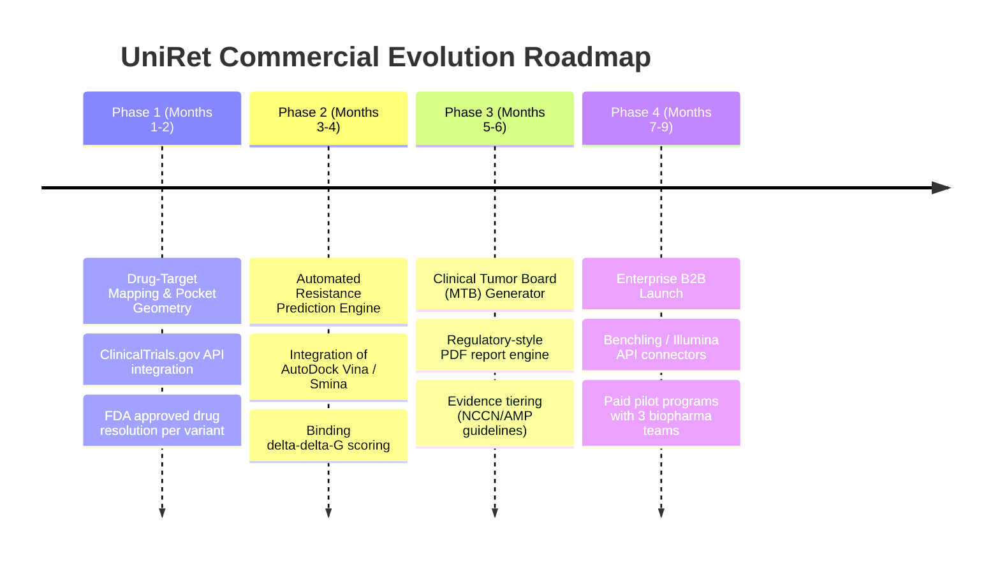

# UniRet Commercial Strategy & Unique Selling Proposition (USP)

> **Document Type**: Commercial Product Strategy & Defensibility Blueprint  
> **Target Audience**: Product Leadership, Investors, Biotech Founders, Enterprise Customers  
> **Platform**: UniRet v2 $\to$ Commercial Transition  
> **Date**: November 2026  

---

## 1. The Harsh Reality: Why Parsers & Visualizers Fail Commercially

UniRet v2 in its current architecture is a well-engineered **bioinformatics utility**:
- It pulls from open, public APIs (EBI Proteins API, UniProt, AlphaFold DB, RCSB PDB).
- It flattens and categorizes nested JSON structures into clean tables.
- It renders 1D density skylines and 3D macromolecular structures via open-source WebGL libraries (3Dmol.js).

### The Commodity Trap
In the commercial B2B biotech and pharma software landscape, **pure parsers and visualizers have zero pricing power**:
1. **Public Data Parity**: Any computational biology team with Python and BioPython can write a scraping/parsing script in an afternoon.
2. **Free Upstream Portals**: UniProt has its own interactive Variant Viewer; AlphaFold DB provides 3D viewers; PDBe-KB and RCSB PDB have 3D mutation mappers.
3. **No ROI Justification**: A VP of Computational Biology or Head of Oncology Drug Discovery cannot justify a \$20k–\$100k annual software budget simply to "format CSVs or look at standard cartoon structures."

### The Golden Rule of Commercial Biotech SaaS
> **"Nobody pays for descriptive data (what already exists). Companies pay premium dollars for predictive insight (what will happen) and prescriptive action (what decision to make next)."**

To transform UniRet from an academic open-source side project into a defensible, venture-scale or high-margin B2B commercial product, UniRet must transition from:
$$\text{Data Ingestion \& Formatting} \longrightarrow \mathbf{Actionable\ Decision\ Intelligence}$$

---

## 2. Competitive Landscape & Market White Space

```mermaid
quadrantChart
    title Commercial Biotech Landscape (Variant & Structure)
    x-axis Low Actionability (Raw Data) --> High Actionability (Clinical / Drug Decisions)
    y-axis Sequence-Only Analysis --> 3D Structural / Pocket Physics
    point1 [UniProt / EBI Viewer] : [0.25, 0.40]
    point2 [cBioPortal] : [0.55, 0.20]
    point3 [ClinVar / NCBI] : [0.40, 0.10]
    point4 [Schrödinger / PyMOL] : [0.35, 0.90]
    point5 [AlphaMissense / ESM] : [0.45, 0.50]
    point6 [Current UniRet v2] : [0.30, 0.65]
    point7 [UniRet Commercial Target (USP)] : [0.88, 0.85]
```

### The Unmet Need (The White Space)
Current tools exist in isolated silos:
- **Schrödinger / Molecular Dynamics**: Extremely powerful 3D physics, but costs \$80,000+/seat, requires dedicated computational chemists, and lacks real-time clinical genomic feeds.
- **cBioPortal / ClinVar**: Excellent clinical cohort tables, but completely detached from 3D active-site pocket physics and structural drug resistance mechanisms.
- **AlphaMissense / PredictSNP**: Provide black-box numerical pathogenicity scores without explaining **why** or **which approved drug will still bind**.

**The White Space**: A lightweight, real-time platform that sits directly at the intersection of **3D Drug Pocket Geometry**, **Clinical Genomic Registries**, and **Drug Resistance Prediction**.

---

## 3. Four Commercial USP Archetypes

Here are four distinct, high-margin commercial angles evaluated for market size, defensibility, and engineering feasibility:

---

### Archetype A: The "Pre-Relapse" Drug Resistance Engine (Recommended Hero USP)
*Predicting On-Target Resistance Mutations Before Clinical Trials or Patient Relapse*

- **Target Customers**: Oncology Biopharma (Medicinal Chemists, Preclinical Pharmacology, Translational Oncology Teams).
- **The Burning Pain**: 
  - Over 70% of targeted small-molecule inhibitors and ADCs (e.g., against EGFR, KIT, BRAF, ALK, KRAS, BTK) fail within 12–18 months of clinical use due to **acquired resistance mutations**.
  - Discovering that a \$200M Phase 2 candidate is vulnerable to a single gatekeeper mutation (e.g., KIT T670I or EGFR T790M/C797S) during clinical trials can kill an entire drug program.
- **The Core Product Capability**:
  1. **In Silico Resistance Mutagenesis**: For any target protein and co-crystallized or docked ligand, automatically simulate all 19 possible amino acid substitutions across the 10Å binding pocket.
  2. **Resistance Risk Matrix ($\Delta\Delta G_{bind}$ + Steric Clash)**: Combines structural pocket physics with sequence constraint models to score:
     - *Will the protein still fold and function?* (Viability score)
     - *Will the drug lose binding affinity?* (Resistance score)
     - *Has this variant already been spotted in patient cohorts (ClinVar/COSMIC)?* (Surveillance alert)
  3. **Next-Generation Scaffold Suggestions**: Flags which chemical substituents or drug derivatives maintain efficacy against the predicted mutant pocket.
- **Pricing & Business Model**: 
  - Tiered SaaS: **\$35,000 – \$90,000 / company / year** (covers unlimited target screens and pipeline monitoring).

---

### Archetype B: Automated Molecular Tumor Board (MTB) & N-of-1 Therapeutic Matcher
*From Patient VCF Variant $\to$ 3D Mechanism $\to$ Approved Drug / Clinical Trial Recommendation in 30 Seconds*

- **Target Customers**: Hospital Cancer Centers, Precision Oncology Clinics, Clinical Genomic Testing Labs (Foundation Medicine, Tempus, Guardant Health competitors).
- **The Burning Pain**:
  - Molecular pathologists spend 4–8 hours per patient case researching rare missense variants (VUS) to determine if a patient with an atypical mutation will respond to off-label targeted therapy or active trials.
- **The Core Product Capability**:
  1. **Instant VUS De-obscuration**: Upload patient variant $\to$ maps location onto 3D structure. If the VUS lands directly in the active kinase pocket next to known pathogenic drivers, it generates high-confidence structural evidence of oncogenicity.
  2. **Real-Time Clinical Trial & Drug Matching**: Matches the mutated pocket to open, recruiting Phase 1–3 trials on ClinicalTrials.gov and FDA/NCCN off-label indications.
  3. **One-Click Regulatory-Compliant MTB PDF Summary**: Generates a publication-grade, signed medical summary with 3D pocket snapshots, literature citations, and therapeutic tiering (Tier I: FDA Approved; Tier II: Clinical Evidence; Tier III: VUS/Preclinical).
- **Pricing & Business Model**:
  - **\$150 – \$350 per analyzed patient case** or **\$2,500/month** clinic subscription.

---

### Archetype C: Biotherapeutic & Protein Engineering De-risking Portal
*Stability, Solubility, and Immunogenicity Screening for Engineered Enzymes & Antibodies*

- **Target Customers**: Synthetic Biology companies (Ginkgo Bioworks, Amyris-type entities), Industrial Enzyme Designers, Antibody Engineering Teams.
- **The Burning Pain**:
  - Introducing point mutations to improve enzyme catalytic efficiency often causes protein aggregation, thermal instability, or human anti-drug antibody (ADA) immunogenicity.
- **The Core Product Capability**:
  1. **Multiparameter Fitness Scoring**: Calculates the structural consequence of any introduced mutation:
     - Thermostability ($\Delta\Delta G_{fold}$)
     - Aggregation Propensity (hydrophobic patch exposure)
     - Surface Charge & Isoelectric Point ($\text{pI}$) Shifts
     - Immunogenic MHC-II Binding Prediction (NetMHCIIpan integration)
  2. **Pareto Optimization Matrix**: Surfaces the "sweet spot" mutations that maximize catalytic performance while minimizing aggregation risk.
- **Pricing & Business Model**:
  - **\$15,000 – \$45,000 / team / year**.

---

### Archetype D: Variant IP Landscaping & Freedom-to-Operate (FTO) Analyzer
*Sequence-Structure Patent Intelligence for Biotech Intellectual Property*

- **Target Customers**: Biotech Patent Attorneys, Business Development (BD) Teams, Life Sciences VCs.
- **The Burning Pain**:
  - Assessing whether an engineered enzyme variant or modified therapeutic protein infringes on existing broad Markush patent claims takes weeks of manual legal-scientific review.
- **The Core Product Capability**:
  1. **3D Patent Coverage Heatmap**: Cross-references protein sequences against Google Patents, USPTO, and EPO claim databases.
  2. **"White Space" Residue Highlighting**: Directly paints 3D structures with patent ownership:
     - 🔴 Red Residues: Patented claims covering specific substitutions.
     - 🟢 Green Residues: Unencumbered freedom-to-operate (FTO) positions available for patenting.
- **Pricing & Business Model**:
  - **\$1,500 – \$5,000 per patent clearance search** or **\$50,000/year** enterprise IP intelligence license.

---

## 4. The Recommended Commercial Hero USP: "UniRet OncoPredict"

### The Pitch
> **"UniRet is the first Real-Time 3D Drug Resistance & Precision Oncology Engine. We combine AlphaFold macromolecular pocket geometry with clinical genomic registries to predict acquired drug resistance mutations before clinical trials fail, and match rare patient variants to actionable therapies in seconds."**

```
┌──────────────────────────────────────────────────────────────────────────────┐
│                             UNIRET ONCOPREDICT                               │
├──────────────────────────────────────────────────────────────────────────────┤
│  INPUT: Protein (KIT / P10721) + Drug (Imatinib / Gleevec)                   │
├──────────────────────────────────────────────────────────────────────────────┤
│                                                                              │
│  [ 3D Active Pocket ]      [ Resistance Risk Matrix ]      [ Action Plan ]   │
│   • 8Å Pocket Scan          • T670I (Gatekeeper)  [HIGH]    • Switch to:     │
│   • Steric Clash Detect     • V654A (ATP Pocket)  [MED]       Sunitinib      │
│   • Affinity Shift          • D816V (Activation)  [RESIST]    Ripretinib     │
│                                                                              │
├──────────────────────────────────────────────────────────────────────────────┤
│  OUTPUT: 1-Click Molecular Tumor Board Report | Clinical Trial Matches       │
└──────────────────────────────────────────────────────────────────────────────┘
```

### Why This USP Wins
1. **Leverages What Already Exists**:
   - UniRet already has the 3D WebGL viewer (`StructureViewer3D.jsx`).
   - UniRet already has the UniProt/EBI variation catalog (`VariationsTable.jsx`).
   - UniRet already parses PredictSNP coordinates and dbSNP rsIDs.
2. **Defensible Differentiation**:
   - Upstream portals (UniProt, AlphaFold DB) will **never** provide commercial drug resistance predictions or clinical trial matching due to institutional mandates.
   - Schrödinger and MOE are desktop-bound, complex physics engines requiring specialized computational chemists; UniRet is instant, cloud-native, browser-accessible, and accessible to any oncologist or wet-lab scientist.
3. **High Willingness to Pay**:
   - Pharma drug programs spend \$500k+ on physical *in vitro* saturation mutagenesis screens (deep mutational scanning / DMS) to discover resistance mutations. Providing instant computational screening saves months of wet-lab time and hundreds of thousands of dollars.

---

## 5. The Browser-First / Zero-Cloud-Compute Architecture Blueprint

### The Technical Dilemma
Running live molecular docking (e.g., AutoDock Vina, GNINA) or molecular dynamics (OpenMM) in real-time creates severe commercial and technical friction:
- **Cloud Infrastructure Costs**: Live docking requires expensive GPU instances or high-vCPU nodes, costing thousands of dollars per month in server bills.
- **Latency**: Docking takes 30 seconds to several minutes per compound-pocket pose, destroying the snappy, real-time user experience.
- **Client Limitations**: Browser-based WebGL apps cannot run heavy C++/CUDA physics simulations locally without freezing the browser or draining laptop batteries.

### The Solution: "Pre-Indexed Intelligence + Client-Side Geometric Heuristics"
The breakthrough insight is:
> **You do not need to run live docking in the browser to deliver predictive resistance and clinical actionability.**

Instead, modern high-scale bioinformatics platforms use a **hybrid browser-first model**:

```
┌────────────────────────────────────────────────────────────────────────────────┐
│                           BROWSER-FIRST WORKFLOW                               │
├────────────────────────────────────────────────────────────────────────────────┤
│                                                                                │
│  1. Client-Side 3D Vector Geometry (Runs in <5ms in JavaScript)                │
│     • Euclidean distance to ligand atoms (<4Å Gatekeeper, 4-8Å Pocket Shell)   │
│     • Sidechain Volume Delta (ΔV in ų) → Predicts steric clash                │
│     • Charge & Isoelectric Delta (Δq) → Predicts loss of salt bridges          │
│     • Client-Side SASA (Shrake-Rupley in JS) → Core vs. Surface exposure       │
│                                                                                │
│  2. Curated Pre-Computed Resistance Atlas (Zero-Compute $O(1)$ Lookup)          │
│     • Top 200 oncology kinase/target complexes pre-docked offline once         │
│     • Tiny static JSON payloads (~150 KB) loaded instantly via CDN             │
│     • Precomputed AlphaMissense & FoldX ΔΔG scores indexed by UniProt ID       │
│                                                                                │
│  3. Free Serverless REST APIs (Live Clinical Intelligence)                     │
│     • ClinicalTrials.gov API v2 → Live recruiting trial matching               │
│     • CIViC DB API (civicdb.org) → Curated clinical resistance evidence       │
│     • OpenFDA Drug Label API → Approved indications and black-box warnings     │
│                                                                                │
└────────────────────────────────────────────────────────────────────────────────┘
```

---

### Technical Capabilities That Run 100% in the Browser

#### 1. Instant 3D Pocket Geometry & Clash Detection (< 5 ms)
When an AlphaFold or PDB crystal structure with a bound ligand is rendered in 3Dmol.js:
- **Ligand Distance Calculation**: For each atom in the mutated amino acid sidechain, calculate the Euclidean distance to the nearest ligand atom:
  $$d_{\min} = \min_{i,j} \sqrt{(x_i - x_j)^2 + (y_i - y_j)^2 + (z_i - z_j)^2}$$
  - $d_{\min} < 4.0\text{ \AA}$: **Direct Gatekeeper / Contact Zone** (immediate risk of drug displacement).
  - $4.0 \le d_{\min} \le 8.0\text{ \AA}$: **Binding Pocket Shell** (potential allosteric or entry-channel hindrance).
  - $d_{\min} > 8.0\text{ \AA}$: **Distal / Non-Pocket Residue**.

- **Sidechain Volume Delta ($\Delta V$)**:
  Using an exact amino acid van der Waals volume table:
  $$\Delta V = V_{\text{mutant}} - V_{\text{wildtype}}$$
  - *Example*: In KIT `T670I` (Gatekeeper), Threonine ($116\text{ \AA}^3$) mutates to Isoleucine ($167\text{ \AA}^3$).
  - $\Delta V = +51\text{ \AA}^3$ within a $3.2\text{ \AA}$ contact distance to Imatinib!
  - **Verdict**: Immediate steric occlusion of the ATP pocket. The browser displays this diagnosis in 1 millisecond without running any docking!

- **Charge Inversion ($\Delta q$)**:
  - Detects replacement of charged residues (Asp/Glu $\leftrightarrow$ Lys/Arg) or loss of charge, predicting disrupted electrostatic hydrogen bonds.

#### 2. The "Top 200 Cancer Kinase" Static Atlas
In human oncology, over **90% of targeted therapies focus on ~150 core targets** (*EGFR, KIT, ALK, BRAF, KRAS, PIK3CA, MET, HER2, RET, ROS1, BTK, ABL1, etc.*).
- Instead of computing docking on the fly, pre-generate an optimized static database of co-complexes and pocket definitions.
- When the user searches `P10721` (KIT), the browser fetches a lightweight 150 KB JSON containing:
  - Bound ligand coordinates (Imatinib, Sunitinib, Regorafenib, Ripretinib).
  - Pre-annotated gatekeeper and hinge-region residues.
  - Known clinical resistance outcomes from published clinical trials.
- **Result**: Zero backend compute, \$0 server bills, 60 FPS client-side rendering.

#### 3. Real-Time Clinical Trial & Drug Matching via Public APIs
Precision oncology doctors and researchers do not care about raw docking scores; they care about **therapeutic choices for the patient**:
- **ClinicalTrials.gov API v2**: The frontend can query `https://clinicaltrials.gov/api/v2/studies?query.term={GENE}+{MUTATION}&filter.overallStatus=RECRUITING` directly from the browser.
- **CIViC Open Evidence API**: Queries `https://civicdb.org/api/` for peer-reviewed clinical evidence on whether the variant is sensitive or resistant to specific drugs.
- **OpenFDA API**: Queries FDA drug labels and approvals for the target gene.

#### 4. WebAssembly (Wasm) for Advanced Local Compute (Optional)
If client-side chemical intelligence is needed without server overhead:
- **RDKit.js (WebAssembly)**: Runs full cheminformatics, molecular weight, logP, SMILES parsing, and 2D chemical structure rendering directly inside the browser thread.
- **Pyodide / WebAssembly Scoring**: Lightweight empirical contact scoring functions can run directly on the user's CPU via WebAssembly in $<200\text{ ms}$, requiring **zero server hardware**.

---

## 6. Feature Comparison: Free vs. Commercial Tier

| Feature Capability | Free Community Tier (Current v2) | Commercial Pro Tier (\$499/mo) | Commercial Enterprise Tier (\$45k/yr) |
| :--- | :---: | :---: | :---: |
| **Data Ingestion & Flattening** | EBI & UniProt APIs | All + Private VCF upload | Multi-cohort bulk pipeline |
| **1D Skyline & 3D WebGL Viewer** | AlphaFold & RCSB PDB | Included | High-res presentation export |
| **PredictSNP Exporter** | CSV / TXT download | API integration | Automated webhook triggers |
| **Binding Pocket Identification** | Manual inspection | Automated 8Å pocket detection | Auto-docking with user ligands |
| **Drug Resistance Scoring** | None | Precomputed kinase/target scores | Live in silico $\Delta\Delta G_{bind}$ prediction |
| **Clinical Trial Matching** | External links only | Live ClinicalTrials.gov matching | Filter by phase, sponsor & location |
| **Molecular Tumor Board (MTB)** | None | Watermarked PDF exports | White-label, clinic-ready reports |
| **API & Integrations** | Local FastAPI only | Hosted Cloud REST API | Benchling, DNAnexus & SSO |
| **Support & SLA** | Community / GitHub | 48-hr response | 99.9% uptime + custom targets |

---

## 7. Product Roadmap to Execute the USP



### Phase 1: Drug-Target Mapping & Pocket Geometry (Immediate Value Add)
- Map known kinase inhibitors and approved drugs to UniProt targets (via ChEMBL / Open Targets / DrugBank open data).
- For each protein, automatically flag which variants fall within the **8Å drug-binding pocket**.
- Directly display drug sensitivity/resistance status in the [VariationsTable.jsx](file:///Users/sushant/Projects/Uniret_v2/frontend/src/components/VariationsTable.jsx) and [VariantDetailDrawer.jsx](file:///Users/sushant/Projects/Uniret_v2/frontend/src/components/VariantDetailDrawer.jsx).

### Phase 2: In Silico Drug Resistance Scoring
- Add a lightweight binding affinity scoring module to the backend:
  - When a user selects a drug-protein pair, run fast structural scoring (e.g. via Smina / GNINA or precomputed AlphaMissense / FoldX binding scores).
  - Classify pocket variants into:
    - 🟢 **Sensitive**: Mutation does not disrupt drug contact.
    - 🟡 **Partial Resistance**: Weakened affinity ($\Delta\Delta G_{bind} \ge +1.5\text{ kcal/mol}$).
    - 🔴 **Gatekeeper Resistance**: Steric clash or loss of critical hydrogen bonds.

### Phase 3: One-Click Molecular Tumor Board (MTB) Report Generator
- Implement a 1-click export button in the frontend:
  - Generates a clinical-grade PDF report containing:
    1. Patient variant details and sequence coordinates.
    2. 3D pocket snapshot highlighting the mutated residue.
    3. Clinical significance and population frequencies.
    4. Predicted drug sensitivity vs. resistance.
    5. Currently recruiting clinical trials matching the gene and mutation.

### Phase 4: Enterprise Integrations & Commercial Pilot Launch
- Add enterprise export formats:
  - Formatted for Benchling Notebooks, cBioPortal study packages, and VCF annotation pipelines.
  - Run pilot trials with 3–5 precision oncology research teams or biotech drug discovery startups.

---

## 8. Commercial Go-To-Market (GTM) Strategy

### 1. Developer / Academic Community (Top-of-Funnel Lead Gen)
- Maintain UniRet v2 open source on GitHub as the free community engine.
- Biologists and students use it for basic parsing, PredictSNP formatting, and 3D visualization.
- Every report and view includes a prominent CTA: *"Unlock Predictive Drug Resistance & MTB Reports with UniRet Pro"*.

### 2. Product-Led Growth (Self-Serve Pro Tier)
- Academic researchers and clinical fellows can subscribe at **\$499/month** directly with a credit card for unlimited clinical trial matching, PDF MTB reports, and advanced variant filters.

### 3. Enterprise Direct Sales (Biopharma & Diagnostic Labs)
- Target: Directors of Translational Medicine, Heads of Structural Oncology, VP of Computational Biology at emerging biotechs (\$50M–\$500M market cap).
- Value pitch: *"Screen your clinical candidates against 5,000+ patient mutations to identify escape risks before you enter the clinic."*
- Deal size: **\$35,000 – \$80,000 annual contract value (ACV)**.

---

## 9. Summary: The Core Message

If UniRet remains a parser and 3D viewer, it will be a convenient utility with high academic utility but negligible revenue.

By positioning UniRet as **The Predictive Drug Resistance & Precision Oncology Engine**:
1. You solve a **\$100M+ problem** (anticipating clinical drug failure and acquired resistance).
2. You create an **integrated structural-clinical workflow** that neither UniProt nor Schrödinger currently offers.
3. You unlock high-margin recurring SaaS contracts from both **biopharma oncology pipelines** and **clinical cancer centers**.

